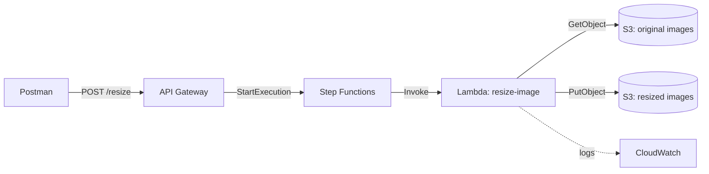
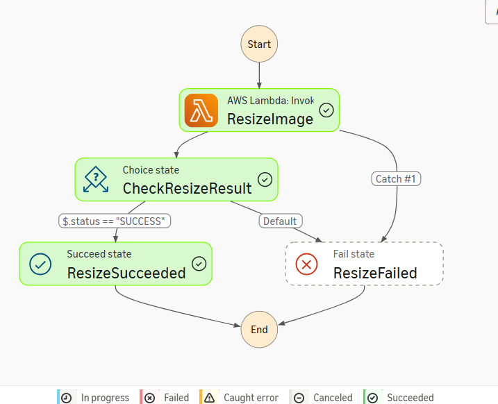
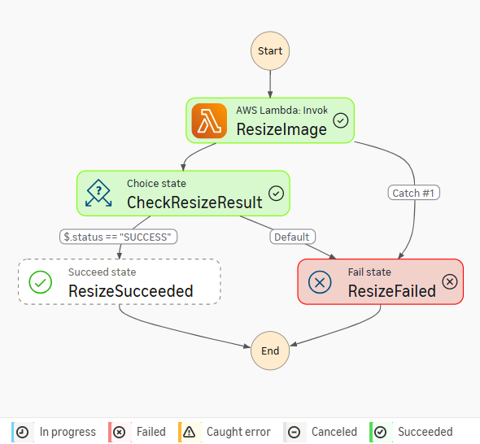
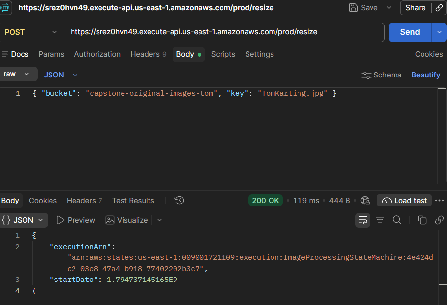
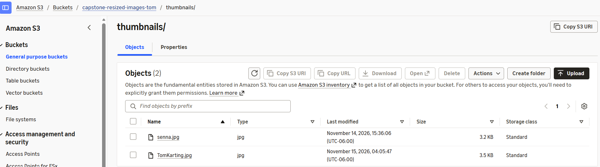

# Serverless Image Processing Pipeline

Saskatchewan Polytechnic | CCMP 200 Capstone | Tom Gabriel Estanislao

This application creates thumbnails of images using AWS. A POST request to API Gateway starts the Step Functions workflow. The workflow runs a Lambda function which resizes an image from one S3 bucket and saves the resized image to another S3 bucket.

## How to Run

1. Upload an image to the `capstone-original-images-tom` bucket.
2. Send a POST request to the URL below. I used Postman, but anything that can send a POST request works.
   ```
   https://srez0hvn49.execute-api.us-east-1.amazonaws.com/prod/resize
   ```
   with this JSON body (use your image's exact file name since S3 names are case-sensitive):
   ```json
   { "bucket": "capstone-original-images-tom", "key": "TomKarting.jpg" }
   ```
3. Postman returns `200 OK` with an `executionArn`.
4. In Step Functions, the execution ends at `ResizeSucceeded`.
5. The thumbnail appears in `capstone-resized-images-tom` under `thumbnails/`.

If the file name doesn't exist in the bucket, the execution ends at `ResizeFailed` instead.

## Architecture



The state machine first runs the `ResizeImage` task, which invokes the Lambda. The Lambda downloads the image, shrinks it with Pillow to 128 px on its longest side, uploads it, and returns `"status": "SUCCESS"` or `"status": "FAILED"`. The `CheckResizeResult` choice state reads that status and goes to `ResizeSucceeded` or `ResizeFailed`. If the Lambda crashes, `Catch` also sends it to `ResizeFailed`.

## Resources

| Resource               | Value                                                                            |
| ---------------------- | -------------------------------------------------------------------------------- |
| Original images bucket | `capstone-original-images-tom`                                                   |
| Resized images bucket  | `capstone-resized-images-tom`                                                    |
| Lambda function        | `resize-image` (Python 3.14, 512 MB, 30 s timeout)                               |
| Lambda layer           | `pillow-py314`                                                                   |
| State machine ARN      | `arn:aws:states:us-east-1:009001721109:stateMachine:ImageProcessingStateMachine` |
| API endpoint           | `POST https://srez0hvn49.execute-api.us-east-1.amazonaws.com/prod/resize`        |

## Prerequisites

- An AWS account in **us-east-1**
- A Pillow Lambda layer for Python 3.14
- AWS CloudShell to build the Pillow layer
- Postman (optional)

## Setting It Up

1. **Buckets:** Create `capstone-original-images-tom` and `capstone-resized-images-tom` with default settings.

2. **Lambda role:** Create an IAM role for Lambda named `capstone-resize-lambda-role`. Attach `AWSLambdaBasicExecutionRole` so it can write logs, and add this inline policy so it can only read from the original bucket and write to the resized one:

   ```json
   {
     "Version": "2012-10-17",
     "Statement": [
       {
         "Effect": "Allow",
         "Action": "s3:GetObject",
         "Resource": "arn:aws:s3:::capstone-original-images-tom/*"
       },
       {
         "Effect": "Allow",
         "Action": "s3:PutObject",
         "Resource": "arn:aws:s3:::capstone-resized-images-tom/*"
       }
     ]
   }
   ```

3. **Pillow layer:** Lambda doesn't include Pillow, and Pillow needs the Linux build that matches the runtime. Run this in CloudShell:

   ```bash
   mkdir -p python
   pip3 install pillow --platform manylinux2014_x86_64 --only-binary=:all: --python-version 3.14 --implementation cp -t python
   zip -r pillow-layer.zip python
   aws lambda publish-layer-version --layer-name pillow-py314 --zip-file fileb://pillow-layer.zip --compatible-runtimes python3.14 --compatible-architectures x86_64
   ```

4. **Lambda:** Create `resize-image` with Python 3.14 and x86_64, using `capstone-resize-lambda-role`. Paste in `src/lambda_function.py`, deploy, add the `pillow-py314` layer, and set memory to 512 MB and timeout to 30 s.

5. **State machine:** Create a Standard state machine named `ImageProcessingStateMachine` from `statemachine/image_processing.asl.json`, and let AWS create its execution role.

6. **API Gateway role:** Create an IAM role for API Gateway named `capstone-apigateway-stepfunctions-role` with this inline policy:

   ```json
   {
     "Version": "2012-10-17",
     "Statement": [
       {
         "Effect": "Allow",
         "Action": "states:StartExecution",
         "Resource": "arn:aws:states:us-east-1:009001721109:stateMachine:ImageProcessingStateMachine"
       }
     ]
   }
   ```

7. **API Gateway:** Create a Regional REST API named `ImageProcessingAPI`. Add a `/resize` resource with a POST method that uses the AWS service integration for Step Functions, action `StartExecution`, and the role from step 6. Add a mapping template for `application/json` using `api-gateway/mapping-template.vtl`, then deploy to a `prod` stage.

## Screenshots

**Successful execution**



**Failed execution (file not in bucket)**



**Postman request**



**Thumbnail saved in S3**



## Problems I Ran Into

- **Lambda timed out.** The first test failed with `Task timed out after 3.00 seconds` and used 115 of 128 MB. Raising memory to 512 MB and the timeout to 30 s fixed it. A resize now takes about 1 second.
- **No Python on my PC.** I couldn't run pip locally to build the Pillow layer, so I built and published it from AWS CloudShell instead.
- **Empty request body.** My first API Gateway test had no request body, so the state machine received `{}` and went to `ResizeFailed`. The mapping template was working correctly; the body was just missing.
- **Missing file showed as AccessDenied.** I sent a request for an image I hadn't uploaded yet. The error said `AccessDenied` for `s3:ListBucket` because the Lambda role can't list the bucket, so S3 hides whether the file exists. Uploading the file fixed it.

## License

MIT License. See [LICENSE](LICENSE).
